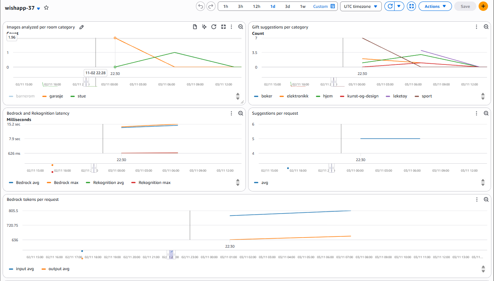
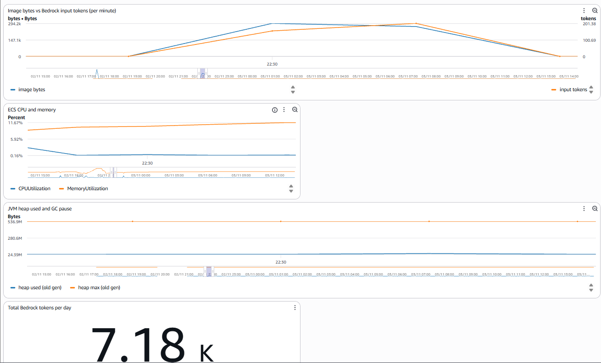

# PGR301 Eksamen 2026 — wishif.ai Kandidat 37

## Oppgave 1

### 1A Containerisér Spring Boot-applikasjonen:

```
docker build -t wishapp .
docker run -p 9999:8080 wishapp
```
### 1B CI-pipeline:
CD workflow nyeste:
\
CI workflow nyeste: \

CI oppgave 1B:
https://github.com/TPhong95/PGR301-Eksamen-2026/actions/runs/41337500204 \
CD oppgave 1B:
https://github.com/TPhong95/PGR301-Eksamen-2026/actions/runs/41337500244

Jeg har valgt å dele CI og CD i to forskjellige filer, hvor CI sjekker koden og tester og CD behandler deployment delen. Egentlig skulle CI ha skjedd i en pull request til main, men for hastighet av testing og for lett arbeidsflyt så er den satt på push istedet. Men tanken er at hvis ikke CI er godkjent kan man ikke gjøre en merge/push til main med feature branchen.

Tagging strategien går på versions nummeret av applikasjonen fra pom.xml filen med en suffiks av shortet sha nummer på commiten. Versions nummeret følger en global standard for MAJOR.MINOR.PATCH som gjør det lett for mennesker å lese og forstå, mens sha nummeret som er litt mer vanskelig å forstå blir brukt mer til en søke funksjon til å se hvilken commit var det som tilhører imaget. Til slutt pusher vi alltid en latest i tillegg som vil erstatte den forrige latest image slik at vi har en duplikat som er lik den nyeste imaget og er lett å finne.

## Oppgave 2

### 2A Infrastruktur for tjenesten:
URL til tjenesten: 
https://37-a2f376e5a9a241a4959673ef730535a0.ecs.eu-west-1.on.aws/

### 2B Remote state:
Jeg har valgt kandidat nøkkelen min som nøkkel, siden det er unikt mellom meg og mine medelever. Jeg kunne ha vært ekstra forsiktig og lagt til noe ekstra etter nummeret mitt i tilfelle noen hadde skrive feil men, men ser ikke det som nødvendig.

### 2C GitHub Actions-job for Terraform:
\
https://github.com/TPhong95/PGR301-Eksamen-2026/actions/runs/41545303538 

Terraform er avhengig av at imaget finnes i registret i ECR, i tillegg så er den workflowen min avhengig av at den får image tag navnet fra container-build etter at den er ferdig med jobben sin. Og vi vil helst at terraformen skal bruke den nyeste imaget vi har laget siden når vi gjør en push så er det vanligvis noe nytt i koden.

## Oppgave 3

### 3A Infrastruktur for tjenesten:
I Rekognition og Bedrock har jeg lagt til Timer for å måle tida til å kjøre kallet i de servicene.

Bedrock service: \
Jeg har lagt til DistributionSummary for å tracke antall tokens som blir brukt på input tokens og output tokens. I tilegg til å legge en Counter som skal telle total tokens. Dette er hovedsakelig for å se avgiftene for en solo grunder. Det er nyttig å se om en bør bytte model eller benytte enten token kjøp eller subscription basert model. 

Wishlist service: \
Her har vi DistributionSummary for å tracke antall gave tips per request og for hvor mange bytes bilde inneholder. I tilegg har vi en counter for kategori for rom og gave. \
Vi kommer til å bruke bytes for å sammenligne med input tokens for å se om det har noe å si hvor høy oppløsning du laster opp og hvor mange tokens AI bruker for å "se" på bilde. For kategori delen så er det for å se bruks område for applikasjonen vår. Det kan hjelpe med å lage en guide til hva slags bilde som har størst suksess med å finne gaver og hva slags type gaver blir ofte anbefalt av AI

### 3B Dashboard og alarm:
Dashboarded heter wishapp-37:

Begge kategorien widgetene skal måle antall kategorier nevnt av AI når den responderer. Dette kan hjelpe med å analysere hva slags bilder folk sender inn og hva slags output er det AI gir til kundene, dette kan hjelpe med å gi kunde guide på hva hvilke rom de burde sende bilde og for oss kan vi se om vi må fikse prompten vår til AI hvis 90% av anbefaling er for eks leketøy. Den skulle ha tracked per dag istedet for 5 minutter, men for eksamen skyld er den satt til 5 for at data skal synes. Suggestion per request blir brukt hvis vi formulerer promten vår til at den kan inkludere flere anbefalinger, som kan være greit å vite om den gir bare en en flere anbefalinger. Den skulle hatt en minimum og maksimum graf for å se om den har noen edge-caser men siden den alltid gir 5 har jeg bare average på enn så lenge. \
Latency, ECS CPU and memory, JVM heap used and GC pause er for å sjekke helsa til applikasjonen de sjekker average og max. Vi trenger max for å se om vi har noen spikes eller edge-caser i applikasjonen vår. I tillegg til en alarm for bedrock hvis den bruker mer en 10 sekunder på å svare. den heter wishapp-37-bedrock-slow. \
Til slutt har vi en del grafer som tracker tokens med en alarm på antall token bruk i løpet av en dag kalt 
wishapp-37-tokens-daily-high. Dette er viktig ettersom vi kjører Claude og jeg vil tro dette ikke er en lokal AI model. Det kan fort hende at man bruker mer tokens enn nødvendig. Så vi sjekker om størrelse på bilde har noe å si på tokens og hvor mange tokens vi bruker per request, og gjennomsnittet per dag. Vi har noen eksempler som https://frvr.com/blog/news/popular-ai-driving-game-devs-forced-to-take-out-loans-as-62000-concurrents-result-in-massive-ai-token-costs/ \
hvor økning av bruker har spist tokens budsjettet og kostet developerne masse penger. Så dette er viktig å vite for en solo-grunder om en skal bytte model til noe mindre kraftig, eller bytte betalings måte fra tokens til subscripting eller omvendt.

## Oppgave 4 Drøfteoppgave:

Testing vil bli vanskelig ettersom atferden er ikke-deterministisk. Og det blir enda verre hvis man bytter model også ettersom den ikke har like atferd og output som den forrige. Dette kan man se med OpenRouter som gir deg en api som roterer mellom forskjellige gratis modeller. Det en kan teste er det ting som vi har fastsatt som eval-setsm, hvor vi forventer en output av en gyldig JSON med alle feltene, eller om f.eks room kategori er innenfor de tillate rommene. Dette kan kjøres i CI pipelinen for blokke merge til main hvis JSON outputten er misdannet. Dette desverre tester bare om outputtet er strukturerer som vi vil, men kvalitet sjekker ikke innholdet for farlige eller upassende svar. \
\
For deployment må vi tracke 3 ting: image tag, prompt version, og modell versjon. I eksamens oppgaven så er prompten hardkodet i Bedrock service, men utenfor det så kan det hende at vi har den et annet sted. Og når du gjør forandring på den kan det hende at outputen blir noe helt annet, selv om vi ikke har gjort noe med selve koden. Og modellen kan få en oppdatering fra leverandøren som endrer oppførselen helt. Et eksempel på model versjon er da ChatGPT gikk fra GPT-4o til GPT-5 hvor den ga litt mer mekanisk svar etter det. Så lenge vi ikke bruker en lokal modell så er det veldig viktig å tracke alle disse 3 tingene ettersom en forandring på en av disse tingene kan forandre hele outputten vår når vi deployer. Det passer med feature flags hvis vi skal bruke en ny prompt eller model ettersom vi kan slå den av og på raskt hvis det er krise. Samtidig kan vi bruke A/B til å rulle ut to ulike versjoner av applikasjonen vår med ulike promtp eller model. Men hvis vi gjør en A/B så bør vi også kansje legge i metrics hvilken versjon dataene kommer fra. Dette kan være spesielt viktig hvis vi skal sammenligne tokenbruk og hastighet på svarene\
\
Automatiske tester vil som hovedsak holde for fleste deterministiske ting a applikasjonenen vår siden der er det bare en sannhet. Men når det gjelder AI modeller så trengs det et menneske bak prompten og endringene dens, ettersom det er der vi spesifiserer og putter på guardrails på hva den burde kunne gjøre og hva den ikke kan gjøre. Model bytte er en viktig handling som burde ha et menneske bak. Et eksempel er med applikasjonen vår som sender inn bilder, vil vi bruke en modell som lagrer ansiktene på kundene våre eller andre private ting den finner in bilde? Eller i medisinsk rådgiving vil en lege heller bruke ChatGPT eller en AI modell som er spesifikt trent på medisinske caser og data? 